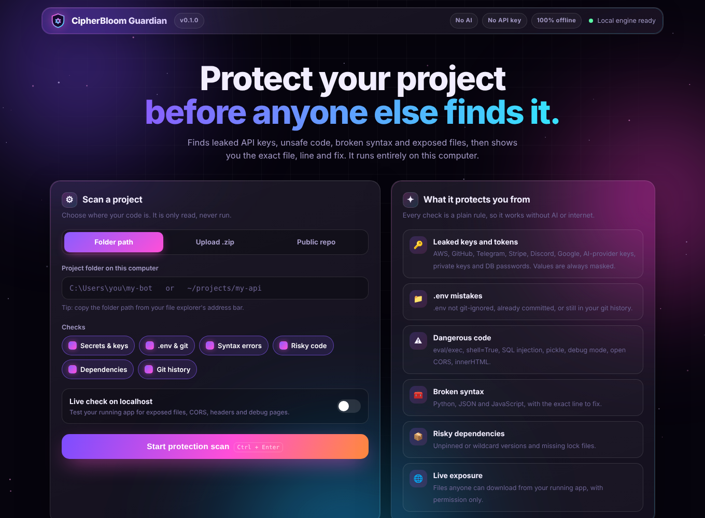
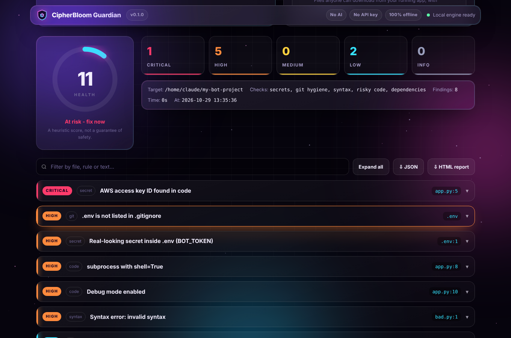
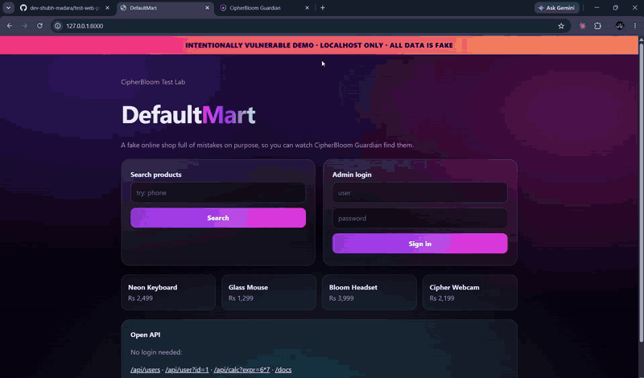
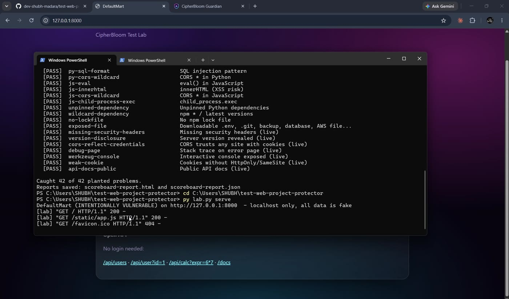
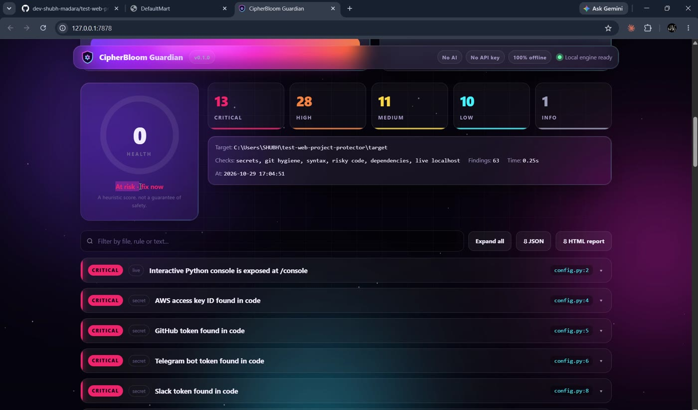
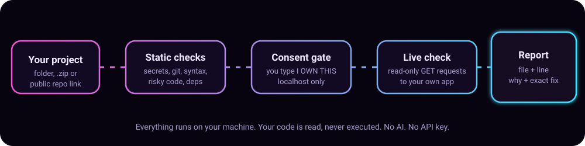

<p align="center">
  
</p>

<p align="center">
  <a href="https://github.com/dev-shubh-madara/project-protector/actions/workflows/ci.yml"></a>
  
  
  
  
  <a href="LICENSE"></a>
</p>

<h3 align="center">Find leaked keys, risky code and exposed files <em>before</em> attackers do.<br>Get the exact file, the exact line and the exact fix.</h3>

<p align="center">
  <a href="#-quick-start">Quick start</a> &nbsp;&bull;&nbsp;
  <a href="#-the-dashboard">Dashboard</a> &nbsp;&bull;&nbsp;
  <a href="#-what-it-checks">What it checks</a> &nbsp;&bull;&nbsp;
  <a href="docs/GUIDE.md">Full guide</a> &nbsp;&bull;&nbsp;
  <a href="#-faq">FAQ</a>
</p>

---

Every week, developers push a bot token, an AWS key or a whole `.env` file to GitHub. Within minutes, bots scrape it, run up bills, take over accounts and steal data. **CipherBloom Guardian** catches those mistakes on your own machine with one command, and explains them in plain language so beginners can fix them too.

<p align="center"></p>

## ✨ Why developers like it

| | |
|---|---|
| 🔒 **Zero trust needed** | Runs **100% offline** on your computer. Your code is read, never executed, never uploaded. |
| 🧠 **No AI, no API key** | Pure Python rules. Free forever, works on a plane, gives the same result every time. AI review is an opt-in extra, never a requirement. |
| 🕵️ **Agent mode** | `cipherbloom agent` plans the checks, investigates every finding and tells you what to fix first. |
| 📍 **File + line + fix** | Every finding tells you *where*, *why it matters* and *exactly how to fix it*. |
| 🪶 **Zero dependencies** | Only the Python standard library. Installs in seconds, nothing to break. |
| 🖥️ **CLI + glass dashboard** | Use the terminal, or open a beautiful localhost dashboard with one command. |
| 🛡️ **Ethical live testing** | Tests your **running localhost app** only after you type `I OWN THIS`. Never touches other sites. |
| ⚡ **Deep sweep (max level)** | An opt-in 2–3 minute localhost audit: ~150 sensitive files, every security header, HTTP methods, a crawl of your pages, and read-only reflection / SQL-error canaries. |
| 🤖 **CI and pre-commit ready** | Block leaked secrets before they're committed, and fail pull requests that contain them. |

## 🚀 Quick start

```bash
# 1. Install (Python 3.10+)
pip install git+https://github.com/dev-shubh-madara/project-protector

# 2. Scan any project
cipherbloom scan path/to/your/project

# 3. Or let the agent investigate and rank the fixes
cipherbloom agent path/to/your/project

# 4. Or open the dashboard
cipherbloom ui
```

That's it. No sign-up, no token, no config file.

<details>
<summary><b>Run without installing</b></summary>

```bash
git clone https://github.com/dev-shubh-madara/project-protector
cd project-protector
python -m cipherbloom scan path/to/your/project
python -m cipherbloom ui
```
</details>

## 🖥️ The dashboard

`cipherbloom ui` opens a glassmorphic dashboard at `http://127.0.0.1:7878`. Scan a **folder**, drag in a **.zip**, or paste a **public repo link**, then filter, search and expand every finding.

<p align="center"></p>
<p align="center"></p>

The dashboard is locked down: it listens on `127.0.0.1` only, rejects foreign `Host` headers (DNS-rebinding protection), refuses cross-site requests, and requires a random per-launch session token.

## 🎬 Proof it works

Real screen recording, nothing staged. CipherBloom Guardian scans [**DefaultMart**](https://github.com/dev-shubh-madara/test-web-project-protector), a shop that is vulnerable on purpose with 42 planted problems, and catches **all 42**.

<p align="center"></p>

<p align="center"><sub>Folder scan + live localhost check, typed consent (<code>I OWN THIS</code>), 63 findings in 0.25 seconds. No AI, no API key, offline.</sub></p>

| The scoreboard | One finding opened |
|---|---|
|  |  |
| `Caught 42 of 42 planted problems.` | File, line, why it matters, how to fix it. Secrets stay masked (`AKIA...EW`). |

**Try it yourself in two minutes:**

```bash
git clone https://github.com/dev-shubh-madara/test-web-project-protector
cd test-web-project-protector
python lab.py scoreboard
```

## 🕵️ Agent mode

A normal scan gives you a long flat list. `cipherbloom agent` works more like a reviewer sitting next to you:

```bash
cipherbloom agent path/to/your/project
```

1. **Looks at the project** (languages, framework, git or not, where the `.env` files are).
2. **Plans** which checks are worth running and says why it skipped the others.
3. **Runs them**, then **investigates every finding** instead of just printing it:
   - Is the secret's file committed, in git history, or safely git-ignored?
   - Is it in browser-facing code that every visitor can download?
   - Does user input (`request.args`, `req.body`, `input()`) reach the risky line *in the same function*, or is it internal-only?
   - Does it sit in a test or example folder?
4. **Links findings that make each other worse** (a tracked `.env` with real keys, injectable code next to debug mode).
5. **Hands you a fix order**, most urgent first, with a `sure / likely / maybe` tag on every finding so you know what to trust.

Every step it took is printed, so nothing is a black box. All of this is still plain Python: no AI, no key, offline.

### Optional: add an AI review

If you want a second opinion from a model, bring your own. Nothing is bundled and nothing is on by default.

```bash
# a local model: nothing leaves your machine, no key needed
export CIPHERBLOOM_LLM_URL=http://localhost:11434/v1
export CIPHERBLOOM_LLM_MODEL=qwen2.5-coder
cipherbloom agent . --ai

# or any OpenAI-compatible service, with your own key
export CIPHERBLOOM_LLM_URL=https://api.openai.com/v1
export CIPHERBLOOM_LLM_MODEL=gpt-4o-mini
export CIPHERBLOOM_LLM_KEY=...        # read from the environment, never a command-line flag
cipherbloom agent . --ai --allow-send-code
```

The model reads code through a few read-only tools, gives a verdict on each finding and may point out extra problems the rules missed. The guard rails:

- Secrets are masked before any text is sent, and `.env`, `.pem` and key files can't be read at all.
- A non-local endpoint is refused unless you pass `--allow-send-code`, and plain `http://` to a remote host is always refused.
- The model can't write files, run anything or leave the project folder.
- It can't remove or downgrade a finding. A "probably a false positive" verdict only adds a note. Its own suggestions are labelled `ai-suggested` and never count towards `--fail-on`.
- Project files are treated as untrusted text. A comment saying "ignore your instructions" can at worst skew a note, not hide a finding.

Models make mistakes, so treat the AI notes as hints and check them.

## 🔍 What it checks

| Check | What it finds | Example fix it gives you |
|---|---|---|
| **Secrets** | AWS, GitHub, Telegram, Slack, Stripe, Discord, Google and AI-provider keys, private keys, DB URLs with passwords, high-entropy hard-coded secrets | "Open @BotFather, run /revoke, load it from an env variable" |
| **.env & git** | `.env` not in `.gitignore`, `.env` tracked by git, `.env` still in **git history**, no `.env.example` | `git rm --cached .env`, then rotate the keys |
| **Risky code** | `eval`/`exec`, `shell=True`, `os.system`, SQL built with f-strings, `pickle`, unsafe `yaml.load`, `debug=True`, `verify=False`, CORS `*`, `innerHTML` | "Use placeholders: `execute('... WHERE id = ?', (uid,))`" |
| **Syntax** | Python, JSON and JavaScript syntax errors (JS uses Node if installed) | "Open `utils.py` at line 7 and fix: unexpected indent" |
| **Dependencies** | Unpinned `requirements.txt` lines, `*`/`latest` npm versions, missing lock files; optional `pip-audit` / `npm audit` | "Pin it: `name==1.2.3`" |
| **Live (localhost)** | Downloadable `.env` / `.git` / backups / DB files, CORS that trusts any site, missing security headers, stack-trace debug pages, exposed Werkzeug console, directory listing, weak cookies | "Serve only a `public/` folder, never the project root" |

Secret values are **always masked** in output (`AKIA...56`), so reports are safe to share.

## ⚙️ How it works

<p align="center"></p>

## 🧰 Command reference

```text
cipherbloom scan [SOURCE]           Scan a folder (default .), a .zip or an https repo link
    --live URL                      Also run the consent-based live check on YOUR localhost app
    --deep                          Max-level live check: a thorough 2-3 minute localhost sweep
    --yes-i-own-this                Give live-check consent non-interactively (CI)
    --html FILE / --json FILE       Save an animated HTML report or a JSON report
    --fail-on LEVEL                 Exit 1 if any finding is at/above LEVEL (critical..info)
    --audit                         Also run pip-audit / npm audit if installed (uses network)
    --no-history                    Skip the git-history check
    --staged                        Only check staged files (used by the pre-commit hook)
    --no-color / --quiet

cipherbloom agent [SOURCE]          Plan, investigate and rank the fixes (offline, no AI)
    --ai                            Add an AI review using YOUR model (see Agent mode)
    --ai-url URL / --ai-model NAME  OpenAI-compatible endpoint and model (or the CIPHERBLOOM_LLM_* env vars)
    --allow-send-code               Agree to send masked snippets to a non-local endpoint
    --ai-steps N                    Max tool steps the AI may take (default 12)
    --live / --deep / --html / --json / --fail-on / --no-history   Same as scan; the JSON also holds the trace and fix plan

cipherbloom ui [--port 7878] [--no-open]   Open the localhost dashboard
cipherbloom hook install|uninstall [PATH]  Block commits that contain secrets
```

Silence a known-safe line with a trailing comment: `# cipherbloom:ignore`. Put `# cipherbloom:ignore-file` in the first 5 lines of a file to skip the whole file for secret and risky-code checks.

## 🤖 Use it in GitHub Actions

```yaml
# .github/workflows/security.yml
name: Security
on: [push, pull_request]
jobs:
  guardian:
    runs-on: ubuntu-latest
    steps:
      - uses: actions/checkout@v4
        with: { fetch-depth: 0 }      # full history so old .env commits are found
      - uses: dev-shubh-madara/project-protector@main
        with:
          fail-on: high
```

The HTML report is uploaded as a build artifact automatically.

## ❓ FAQ

**Do I need an AI API key or any paid service?**
No. Every check, and the agent's planning and investigating, is plain Python. Nothing is sent anywhere. The AI review (`--ai`) is optional and uses a model you provide, local or hosted.

**Is the agent actually "AI"?**
By default it is an agent in the plan, act, observe sense (it chooses checks, follows up on each finding, links them and ranks the fixes) but the reasoning is hand-written rules, not a language model. Add `--ai` if you want a model in the loop.

**Will it run my code?**
No. It only reads files. The live check sends ordinary GET requests to an app *you* already started on localhost.

**Can I use it to test someone else's website?**
No, and that's deliberate. The live check refuses every address that isn't `localhost` / `127.0.0.1`, and it requires your typed consent.

**What is the deep sweep (`--deep`)?**
A slow, thorough version of the live check for your own app. Turn it on with `--deep` on the CLI, or the **Deep sweep** switch in the dashboard. It takes 2–3 minutes and sends several hundred paced, read-only requests: ~150 sensitive-file paths (`.env`, `.git`/`.svn`, backups, SQL dumps, keys, CI secrets, logs), every modern security header, every cookie's flags, CORS, risky HTTP methods (`PUT`/`DELETE`/`TRACE`), admin/debug endpoints, a crawl of your own linked pages, and harmless reflection / SQL-error canaries (a marker string and a single quote — nothing destructive). It is paced on purpose so it stays a polite audit, never a flood.

**Does a score of 100 mean my project is secure?**
No. It means these checks passed. CipherBloom catches the most common, most expensive mistakes. It's not a replacement for a professional security review.

**It flagged something that's fine. What now?**
Add `# cipherbloom:ignore` to that line, or open an issue so the rule can be improved.

## 🗺️ Roadmap

- [ ] Agent results inside the dashboard
- [ ] More secret providers (Twilio, SendGrid, Supabase, Firebase, Hugging Face)
- [ ] Framework-aware route mapping for live findings (FastAPI, Flask, Express)
- [ ] SARIF output for GitHub code scanning
- [ ] `cipherbloom fix` to auto-add `.gitignore` entries and generate `.env.example`
- [ ] VS Code extension

Have an idea? [Open an issue](https://github.com/dev-shubh-madara/project-protector/issues). Rules are small, so they make great first contributions.

## 🤝 Contributing

Contributions are welcome. Read [CONTRIBUTING.md](CONTRIBUTING.md) for how to add a rule in about 10 lines. Please report vulnerabilities privately as described in [SECURITY.md](SECURITY.md).

## 📜 License

[MIT](LICENSE) © 2026 Shubh Kumar Mishra (Madara)

<p align="center"><sub>If CipherBloom Guardian saved you from a leaked key, please ⭐ the repo so more developers find it.</sub></p>
